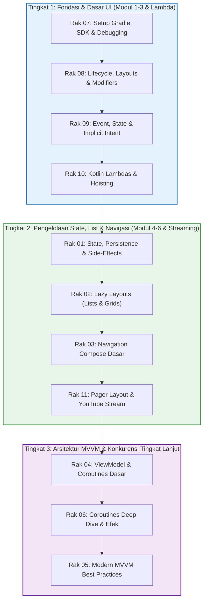

# 📚 Katalog Rak Referensi: Modern Android Development (MAD)

Selamat datang di direktori **Rak Referensi Modular (`/docs/references/`)**.  
Koleksi modul ini dirancang khusus dengan format terstruktur, modular, dan saling terhubung (*interconnected*) dengan metadata frontmatter, breadcrumbs, dan cross-reference link. Desain ini dibuat agar mempermudah **AI Agent** maupun developer dalam membaca, menelusuri, dan mengimplementasikan seluruh materi praktikum dan teori arsitektur Android modern menggunakan Kotlin, Jetpack Compose, Coroutines, dan MVVM.

---

## 🗺️ Peta Navigasi Rak (*Shelf Structure*)

```
docs/references/
├── README.md                                         # 📌 Master Index & Katalog Rak (File Ini)
├── GLOSSARY.md                                       # 📖 Glosarium & Kamus Istilah Terpadu (25+ Istilah)
│
├── 07-gradle-setup-and-debugging/                    # 🛠️ RAK 07: Setup Gradle, SDK, Debug & Entry Point (Modul 1)
│   ├── 01-gradle-sdk-configuration.md                # minSdk <= targetSdk <= compileSdk, JDK 17, JVM Target
│   ├── 02-version-catalog-toml-guide.md              # libs.versions.toml, alias typesafe vs format jadul
│   ├── 03-debugging-logcat-and-breakpoints.md        # Logcat AndroidRuntime, Log levels, Shift+F9, Step Over (F8)
│   ├── 04-mainactivity-and-manifest-entry-point.md   # AndroidManifest.xml, <intent-filter> MAIN/LAUNCHER, setContent
│   └── 05-lab-experiments-and-task.md               # Praktikum Modul 1 (Coil AsyncImage, Fix ArithmeticException)
│
├── 08-activity-lifecycle-and-basic-ui/               # 🔄 RAK 08: Activity Lifecycle, Basic Layout & Modifier (Modul 2)
│   ├── 01-activity-lifecycle-transitions.md          # 7 Callback Siklus Hidup (onCreate -> onDestroy), Back Stack
│   ├── 02-composable-layouts-column-row-box.md       # Layout Primitif: Column, Row, Box (z-index stacking)
│   ├── 03-modifier-chaining-order-matters.md         # Modifier: Order Matters (.clip().background() vs sebaliknya)
│   └── 04-lab-contact-us-and-profile.md              # Praktikum Modul 2 (ContactUs WhatsApp, ProfilMahasiswa, Analisis Draft)
│
├── 09-event-state-and-implicit-intent/               # ⚡ RAK 09: Event, State & Implicit Intent (Modul 3 Revisi)
│   ├── 01-imperative-vs-declarative-ui.md            # Perbandingan Paradigma: XML (FindViewById) vs Compose
│   ├── 02-event-handling-and-compose-state.md        # UDF (Event Up, State Down), mutableStateOf, Recomposition
│   ├── 03-property-delegation-by-keyword.md          # Delegasi Properti Kotlin (by getValue/setValue vs .value)
│   ├── 04-implicit-intent-actions-and-uris.md        # Intent Implisit (ACTION_VIEW, SEND, CALL, DIAL) & URI Scheme
│   └── 05-lab-experiments-and-recomposition-analysis.md # Praktikum Modul 3 + 20 Soal Analisis Rekomposisi & Intent
│
├── 10-kotlin-lambdas-and-hoisting/                   # 🧩 RAK 10: Fondasi Lambda & State Hoisting di Compose
│   ├── 01-lambda-expressions-and-syntax.md           # Sintaks Lambda { x, y -> x + y }, Tipe Data Fungsi
│   ├── 02-higher-order-functions-in-compose.md       # Higher-Order Function (HOC) sebagai Callback Event Compose
│   ├── 03-trailing-lambda-and-it-keyword.md          # Trailing Lambda Syntax (Kurung Kurawal di Luar) & Keyword `it`
│   └── 04-state-hoisting-with-lambdas.md             # Pola Stateless Composable, Pemindahan State ke Caller
│
├── 01-state-and-lifecycle/                           # 🧱 RAK 01: State, Persistence & Side-Effects (Modul 4)
│   ├── 01-state-hoisting-fundamentals.md             # Konsep Lanjutan State Hoisting, SSoT, Reusability
│   ├── 02-configuration-change-and-persistence.md   # remember vs rememberSaveable, Bundle, Rotasi Layar, Process Death
│   ├── 03-side-effects-launchedeffect.md             # Side-Effects, LaunchedEffect, Non-blocking, Memory Leak Prevention
│   └── 04-lab-experiments-and-analysis.md            # Praktikum Modul 4 (Counter, SnackBar Host, Repo Network)
│
├── 02-lazy-layouts/                                  # 📜 RAK 02: Lazy Layouts & Lists Efisien (Modul 5)
│   ├── 01-lazy-lists-column-and-row.md               # LazyColumn & LazyRow, DSL items, Efisiensi Virtualisasi Item
│   ├── 02-lazy-grids-fixed-vs-adaptive.md            # LazyVerticalGrid, GridCells.Fixed vs Adaptive Responsif
│   └── 03-lab-experiments-and-performance.md         # Praktikum Modul 5 (Gadget Model, Uji Landscape & Orientasi)
│
├── 03-navigation/                                    # 🧭 RAK 03: Navigation Compose Dasar (Modul 6)
│   ├── 01-navigation-pillars-and-architecture.md     # 3 Pilar Navigasi (Destination, NavHost, NavController)
│   ├── 02-type-safe-navigation-guide.md              # Type-Safe Nav (Kotlin 2.0+), @Serializable Route Classes
│   ├── 03-savedstatehandle-and-result-passing.md     # Navigasi Balik: SavedStateHandle, Return Data, Parcelable
│   └── 04-lab-experiments-travel-and-profile.md      # Praktikum Modul 6 (Travel Journal & Profile Editor)
│
├── 11-pager-and-youtube-streaming/                   # 📱 RAK 11: Type-Safe Nav Tingkat Lanjut, Pager & YouTube Stream
│   ├── 01-type-safe-navigation-and-backstack-leak.md # Uji Kebocoran Back Stack (NavController leak), PopUpTo & SingleTop
│   ├── 02-forward-data-passing-checkbox-lazycolumn.md# Forward Passing Objek Data via Checkbox LazyColumn ke Detail
│   ├── 03-return-back-data-savedstatehandle-serializable.md # Return-Back Data Editor via SavedStateHandle & PopBackStack
│   └── 04-pager-layout-and-youtube-stream.md         # HorizontalPager, VerticalPager & AndroidView YouTube Player API
│
├── 04-viewmodel/                                     # 🏛️ RAK 04: ViewModel & Dasar Konkurensi (Modul 7)
│   ├── 01-viewmodel-core-and-lifecycle.md            # Peran ViewModel, Lifecycle-Aware, Survivability terhadap Rotasi
│   ├── 02-coroutines-in-android.md                   # Dasar Coroutines, Thread vs Coroutine, Dispatchers.Main/IO/Default
│   └── 03-lab-experiments-calculator-and-threading.md# Praktikum Modul 7 (Kalkulator Diskon, Uji ANR UI Freeze)
│
├── 05-mvvm-best-practices/                           # 🚀 RAK 05: Panduan Arsitektur MVVM Komprehensif
│   ├── 01-architecture-overview-and-udf.md           # Arsitektur 4 Lapisan, UDF, Screen vs Content Composable
│   ├── 02-state-management-stateflow-vs-mutablestate.md # StateFlow vs mutableStateOf, Pola Standar Input TextField
│   ├── 03-reactive-ui-state-combine-and-statein.md   # UI State Reaktif, combine Operator, WhileSubscribed(5_000)
│   ├── 04-remote-data-retrofit-and-serialization.md  # Retrofit 3 suspend fun, Kotlinx Serialization, Sealed Class Error
│   ├── 05-practical-labs-counter-mahasiswa-posts.md  # 4 Praktikum Lengkap (Counter, Mahasiswa, REST API Posts)
│   └── 06-troubleshooting-and-architecture-rules.md  # Tabel Masalah Umum, Kriteria Checklist, Tugas Mandiri
│
└── 06-coroutines-compose-deepdive/                   # ⚡ RAK 06: Coroutine Compose Deep Dive & Studi Kasus
    ├── 01-coroutine-fundamentals-and-dispatchers.md  # Analogi Koki Restoran, Pewarisan Dispatcher, withContext
    ├── 02-compose-coroutine-effects.md               # LaunchedEffect vs rememberCoroutineScope di Lingkungan UI
    └── 03-case-study-countdown-timer-and-analysis.md # Studi Kasus Timer Multi-Key & Analisis Pembatalan (Cancellation)
```

---

## 🎓 Alur Belajar Pedagogis (*Recommended Learning Path*)

Untuk mahasiswa atau AI yang ingin mempelajari ekosistem Android Jetpack Compose dari nol hingga level profesional:



---

## 🔍 Panduan Pencarian Cepat Berdasarkan Kebutuhan (*Quick Lookup*)

Jika AI atau developer membutuhkan rujukan jawaban atas masalah teknis, buka rujukan modul berikut:

| Kebutuhan / Masalah Teknis | Rak & Dokumen Rujukan |
| :--- | :--- |
| **Aturan relasi versi SDK Android (`minSdk`, `targetSdk`, `compileSdk`)** | [01. Gradle SDK Configuration](./07-gradle-setup-and-debugging/01-gradle-sdk-configuration.md) |
| **Konfigurasi Version Catalog `libs.versions.toml` vs string hardcoded** | [02. Version Catalog TOML Guide](./07-gradle-setup-and-debugging/02-version-catalog-toml-guide.md) |
| **Cara debugging crash `AndroidRuntime` & Breakpoint (F8 Step Over)** | [03. Debugging Logcat & Breakpoints](./07-gradle-setup-and-debugging/03-debugging-logcat-and-breakpoints.md) |
| **Aplikasi tidak muncul di Launcher / Activity tidak jalan** | [04. MainActivity & Manifest Entry Point](./07-gradle-setup-and-debugging/04-mainactivity-and-manifest-entry-point.md) |
| **Urutan transisi siklus hidup Activity saat ditekan Home / Back / Rotasi** | [01. Activity Lifecycle Transitions](./08-activity-lifecycle-and-basic-ui/01-activity-lifecycle-transitions.md) |
| **Kapan memakai Column, Row, atau Box untuk layering tumpukan z-index** | [02. Composable Layouts (Column, Row, Box)](./08-activity-lifecycle-and-basic-ui/02-composable-layouts-column-row-box.md) |
| **Kenapa sudut gambar tidak membulat? Urutan Modifier: `.clip()` vs `.background()`** | [03. Modifier Chaining (Order Matters)](./08-activity-lifecycle-and-basic-ui/03-modifier-chaining-order-matters.md) |
| **Beda paradigma Imperatif (XML `findViewById`) vs Deklaratif (Compose)** | [01. Imperative vs Declarative UI](./09-event-state-and-implicit-intent/01-imperative-vs-declarative-ui.md) |
| **Mengapa butuh `by` keyword saat memakai `mutableStateOf` di Composable?** | [03. Property Delegation (`by` keyword)](./09-event-state-and-implicit-intent/03-property-delegation-by-keyword.md) |
| **Cara membuat Implicit Intent WhatsApp, Telepon (`tel:`), Maps (`geo:`) & Web** | [04. Implicit Intent Actions & URIs](./09-event-state-and-implicit-intent/04-implicit-intent-actions-and-uris.md) |
| **Memahami sintaks Lambda Kotlin, Trailing Lambda, dan variabel `it`** | [01. Lambda Expressions & Syntax](./10-kotlin-lambdas-and-hoisting/01-lambda-expressions-and-syntax.md) & [03. Trailing Lambda & `it`](./10-kotlin-lambdas-and-hoisting/03-trailing-lambda-and-it-keyword.md) |
| **Kenapa form input reset saat layar HP diputar (portrait -> landscape)?** | [02. Configuration Change & Persistence](./01-state-and-lifecycle/02-configuration-change-and-persistence.md) |
| **Kapan harus memakai `LaunchedEffect` vs callback biasa?** | [03. Side-Effects & LaunchedEffect](./01-state-and-lifecycle/03-side-effects-launchedeffect.md) |
| **Kapan memilih `LazyColumn` vs `Column` biasa pada daftar data banyak?** | [01. Lazy Lists (Column & Row)](./02-lazy-layouts/01-lazy-lists-column-and-row.md) |
| **Membuat Grid responsif yang otomatis menyesuaikan lebar layar HP & Tablet** | [02. Lazy Grids (Fixed vs Adaptive)](./02-lazy-layouts/02-lazy-grids-fixed-vs-adaptive.md) |
| **Setup Type-Safe Navigation tanpa rawan typo string URL (Kotlin 2.0+)** | [02. Type-Safe Navigation Guide](./03-navigation/02-type-safe-navigation-guide.md) |
| **Mencegah kebocoran Back Stack (Back Stack Leak) saat tombol navigasi ditekan berulang** | [01. Type-Safe Nav & Back Stack Leak Test](./11-pager-and-youtube-streaming/01-type-safe-navigation-and-backstack-leak.md) |
| **Mengirim kumpulan item terpilih (Checkbox) dari LazyColumn ke layar Detail** | [02. Forward Data Passing via LazyColumn](./11-pager-and-youtube-streaming/02-forward-data-passing-checkbox-lazycolumn.md) |
| **Mengembalikan data hasil editan dari Form kembali ke Profile tanpa NavHost baru** | [03. Return-Back Data via SavedStateHandle](./11-pager-and-youtube-streaming/03-return-back-data-savedstatehandle-serializable.md) |
| **Membuat Carousel Horizontal & Vertical Pager di Compose** | [04. Pager Layout & YouTube Stream](./11-pager-and-youtube-streaming/04-pager-layout-and-youtube-stream.md#1-konsep-pager-dalam-jetpack-compose) |
| **Integrasi YouTube Player API AndroidView ke dalam Jetpack Compose** | [04. Pager Layout & YouTube Stream](./11-pager-and-youtube-streaming/04-pager-layout-and-youtube-stream.md#3-integrasi-youtube-player-via-androidview) |
| **Kenapa aplikasi freeze (ANR) saat tombol diklik dan cara memindahkannya ke IO?** | [03. Lab Simulasi ANR Freeze](./04-viewmodel/03-lab-experiments-calculator-and-threading.md#2-percobaan-752-simulasi-freeze-ui-vs-coroutines) |
| **Kapan memakai `mutableStateOf` dan kapan memakai `StateFlow` di ViewModel?** | [02. StateFlow vs mutableStateOf](./05-mvvm-best-practices/02-state-management-stateflow-vs-mutablestate.md) |
| **Kenapa kursor TextField loncat-loncat saat dihubungkan ke Coroutine Flow?** | [02. Pola TextField yang Dianjurkan](./05-mvvm-best-practices/02-state-management-stateflow-vs-mutablestate.md#3-pola-standar-penanganan-input-textfield-yang-dianjurkan) |
| **Mengapa `WhileSubscribed(5_000)` wajib dipakai pada `stateIn`?** | [03. Reactive UI State & WhileSubscribed](./05-mvvm-best-practices/03-reactive-ui-state-combine-and-statein.md#4-mengapa-memakai-sharingsubscribed5_000) |
| **Integrasi Retrofit 3 dengan Kotlinx Serialization dan Sealed Class UI State** | [04. Remote Data Retrofit & Serialization](./05-mvvm-best-practices/04-remote-data-retrofit-and-serialization.md) |
| **Analisis pembatalan job coroutine saat user menekan jeda pada Timer** | [03. Studi Kasus Timer & Analisis Pembatalan](./06-coroutines-compose-deepdive/03-case-study-countdown-timer-and-analysis.md) |
| **Mencari definisi istilah teknis seperti SSoT, UDF, Back Stack, atau Saver?** | [📖 Glosarium & Kamus Istilah Terpadu](./GLOSSARY.md) |

---

## 🏷️ Matriks Modul & Kategori Lengkap

| Rak | Sumber Asli Modul | Kategori | Ringkasan Topik Utama | Tautan Langsung |
| :---: | :--- | :--- | :--- | :--- |
| **Rak 07** | **Modul 1** | Tooling & Setup | minSdk/targetSdk/compileSdk, TOML Version Catalog, Logcat, Breakpoints | [Buka Rak 07](./07-gradle-setup-and-debugging/01-gradle-sdk-configuration.md) |
| **Rak 08** | **Modul 2** | Lifecycle & UI Primitives | 7 Transisi Lifecycle, Column/Row/Box, Modifier Chaining Order | [Buka Rak 08](./08-activity-lifecycle-and-basic-ui/01-activity-lifecycle-transitions.md) |
| **Rak 09** | **Modul 3 Revisi** | State & Interaksi OS | XML vs Compose, UDF, `by` Keyword Delegation, Implicit Intent URI | [Buka Rak 09](./09-event-state-and-implicit-intent/01-imperative-vs-declarative-ui.md) |
| **Rak 10** | **Panduan Lambda** | Kotlin Compose Core | Sintaks Lambda, Higher-Order Functions, Trailing Lambda, Hoisting | [Buka Rak 10](./10-kotlin-lambdas-and-hoisting/01-lambda-expressions-and-syntax.md) |
| **Rak 01** | **Modul 4** | State & Persistence | State Hoisting, rememberSaveable, LaunchedEffect, SnackBar Host | [Buka Rak 01](./01-state-and-lifecycle/01-state-hoisting-fundamentals.md) |
| **Rak 02** | **Modul 5** | Lazy UI Components | LazyColumn, LazyRow, LazyVerticalGrid (Adaptive vs Fixed) | [Buka Rak 02](./02-lazy-layouts/01-lazy-lists-column-and-row.md) |
| **Rak 03** | **Modul 6** | Basic Navigation | 3 Pilar Navigasi, Type-Safe Routes Kotlin 2.0, SavedStateHandle | [Buka Rak 03](./03-navigation/01-navigation-pillars-and-architecture.md) |
| **Rak 11** | **Modul Nav Lanjutan** | Advanced UI & Media | Back Stack Leaks, Forward Checkbox Data, Pager & YouTube Stream | [Buka Rak 11](./11-pager-and-youtube-streaming/01-type-safe-navigation-and-backstack-leak.md) |
| **Rak 04** | **Modul 7** | ViewModel & Concurrency | ViewModel Lifecycle, Dispatchers (Main/IO/Default), Uji ANR UI Freeze | [Buka Rak 04](./04-viewmodel/01-viewmodel-core-and-lifecycle.md) |
| **Rak 06** | **Coroutine V4** | Coroutine Deep Dive | Dispatcher Hierarchy, withContext, LaunchedEffect multi-key Timer | [Buka Rak 06](./06-coroutines-compose-deepdive/01-coroutine-fundamentals-and-dispatchers.md) |
| **Rak 05** | **Panduan MVVM** | Architecture Excellence | 4-Tier MVVM, UDF, combine, stateIn, Retrofit 3, Error Handling | [Buka Rak 05](./05-mvvm-best-practices/01-architecture-overview-and-udf.md) |
| **Kamus** | **Glosarium Terpadu** | Reference Hub | 25+ Definisi Istilah Standar Industri Android Modern | [Buka Glosarium](./GLOSSARY.md) |

---
*Dipersiapkan sebagai rak referensi standar industri dan repositori pengetahuan AI untuk proyek StudentLife App.*
